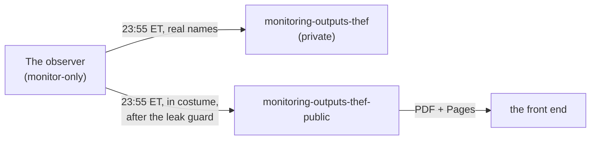

#  monitoring/ — where this observer's dated reports live

*A pointer, not a copy. The reports are written nightly into their own repository pair; this folder says where to find them.*

The arbitrage observer is **monitor-only**: it reads public prices on Arbitrum and writes down what it saw. It holds no wallet that trades and sends no transaction. Each night it writes one page per study day.

| | Where | What it carries |
|---|---|---|
|  **Read it here** | <https://drasticstatic.github.io/monitoring-outputs-thef-public/> | the front end: every dated report with its PDF, on a phone or a laptop, light and dark, no account needed |
|  public repository | [`drasticstatic/monitoring-outputs-thef-public`](https://github.com/drasticstatic/monitoring-outputs-thef-public) | `arb/YYYY-MM-DD/README.md` in costume, `arb/reports.json`, `pdf/`, and the Perps listener's heartbeat page in `perps/` |
|  private repository | `drasticstatic/monitoring-outputs-thef` (private) | the same pages with real names, for the lab and the foundation's readers |
|  the live study | <https://drasticstatic.github.io/trading-bot-arbitrage-public/> and its nightly snapshot [`edge/latest.json`](https://drasticstatic.github.io/trading-bot-arbitrage-public/edge/latest.json) | the public terminal, in costume |
|  phone alerts | [`phone-alerts.html`](https://drasticstatic.github.io/trading-bot-arbitrage-public/phone-alerts.html) | follow the public ntfy topic `fortunatrades-arb-live` |

##  The costume

On every public page, pairs and venues wear **stage names**: a pair is a character such as `curious-oblique-egret`; a venue is a house, and its fee tier a ward, so `Juniper→Rowan Quay` is a route between two houses. Pool depths are scaled by a secret factor per pair. Counts, spreads in percent, gas, hours, lifetimes and outcomes are the real study. A page that would show a real name is not written.

 Icons: [Phosphor](https://github.com/phosphor-icons/core) (MIT), see [`assets/icons/LICENSE-phosphor`](assets/icons/LICENSE-phosphor). Pushed at 23:58 ET each night; each PDF renders a minute after its page lands.
